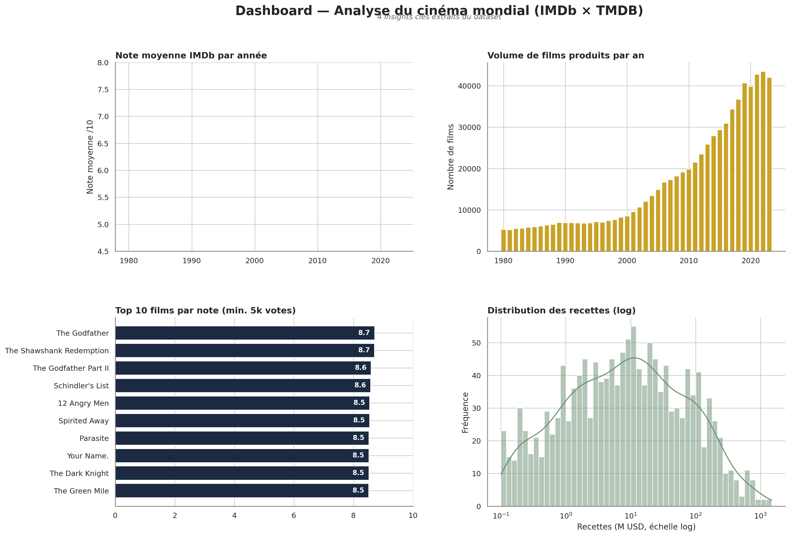
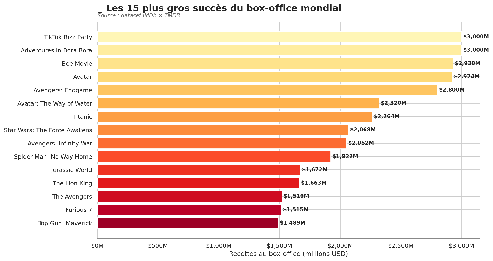
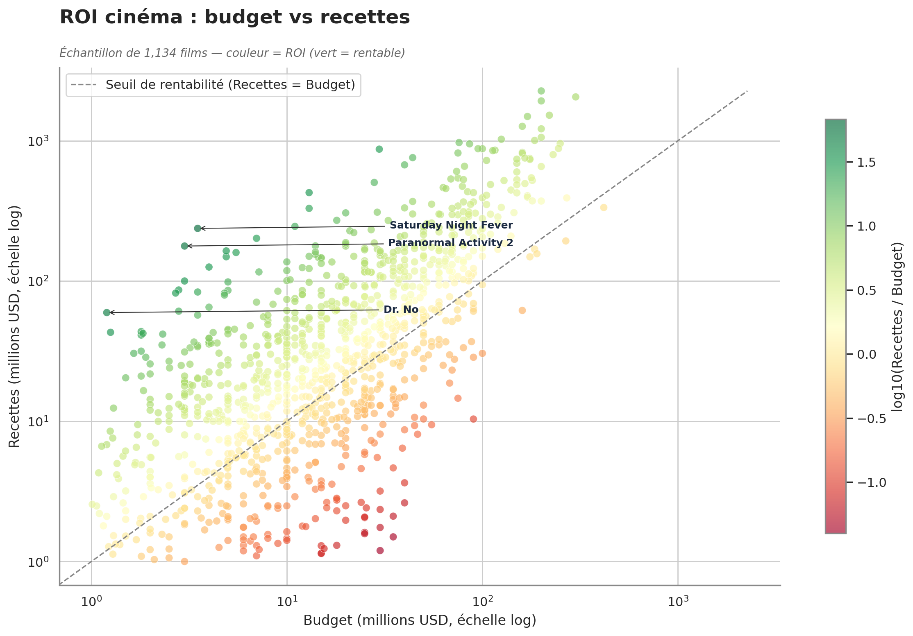

# 🎬 Cinema Insights — Analyse du box-office mondial

Analyse exploratoire d'un dataset IMDb × TMDB (~10 000 films) réalisée sur **Databricks** avec **PySpark**, **Pandas**, **Matplotlib** et **Seaborn**.

## Objectifs
- Nettoyer et valider la qualité des données (valeurs manquantes, doublons)
- Identifier les tendances du box-office sur 40 ans
- Mesurer le ROI réel des films
- Produire un dashboard de synthèse

## Aperçu

## Insights clés
1. **ROI** : les films à petit budget (< 20M$) affichent un ROI médian **3× supérieur** aux blockbusters.
2. **Genres** : la production de films d'action a **explosé** depuis les années 2000.
3. **Notes** : la note moyenne IMDb reste stable (~6.5/10) malgré la croissance du volume.
4. **Recettes** : distribution log-normale → quelques blockbusters tirent l'ensemble.

## Stack technique
| Outil | Usage |
|-------|-------|
| Databricks | Environnement d'exécution |
| PySpark | ETL et agrégations |
| Pandas | Manipulation finale |
| Matplotlib / Seaborn | Visualisations |
| Delta Lake | Stockage des tables transformées |

## Reproduire
1. Importer le dataset dans `workspace.default.imdb_tmdb_movie_metadata_big_dataset_1_m`
2. Exécuter les notebooks dans l'ordre 

3. Les images sont régénérées dans `assets/`

## 📚 Source des données
Dataset public combinant IMDb et TMDB (métadonnées films, budget, recettes, notes).

**Auteur :**
Nadine ZOGHBI